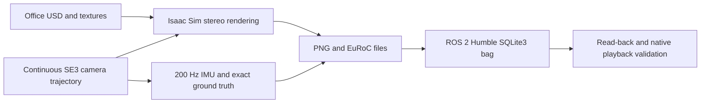

# Isaac Sim Dataset

Generate a reproducible stereo–IMU dataset with exact ground truth in NVIDIA Isaac Sim, and export it as EuRoC-style files and a ROS 2 Humble SQLite3 rosbag. The included scene is NVIDIA's furnished Office environment; it is an authored simulation environment.

Isaac Sim renders the images. A continuous scripted camera trajectory supplies the poses, ideal gyroscope, and ideal accelerometer; seeded noise produces the measured IMU. This workflow does not require robot dynamics or the Isaac ROS bridge.



## Default dataset

| Item | Configuration |
|---|---|
| Recording | 120 s; 5 s stationary at each end |
| Stereo | Grayscale, **width 544 × height 640**, 20 Hz, 2,400 pairs |
| IMU / ground truth | 200 Hz, 24,000 samples each |
| Intrinsics | fx=fy=305.453491, cx=269.162323, cy=313.403473 |
| Baseline | 0.099401839 m |
| Camera model | Rectified pinhole, zero distortion, global shutter |
| IMU placement | Identity extrinsics with left optical camera |
| Axes | Camera/IMU: x right, y down, z forward; world: Z up |
| Route | One closed office/corridor loop, approximately 122 m |

Images have fixed exposure and lighting, with motion blur disabled. Cameras follow prescribed poses. No ground-truth world-to-camera TF is broadcast.

## Setup

Tested on Linux with **Isaac Sim 5.1**, NVIDIA TITAN RTX 24 GB, and ROS 2 Humble for the optional native playback check. Install Isaac Sim using [NVIDIA's installation instructions](https://docs.isaacsim.omniverse.nvidia.com/5.1.0/installation/index.html). Isaac Sim and an NVIDIA GPU are required for rendering; the GitHub CI checks trajectory math on CPU only.

Create a separate Python 3.10 environment for asset preparation and post-processing:

```bash
git clone https://github.com/junlinp/isaac-sim-dataset.git
cd isaac-sim-dataset
python3.10 -m venv .venv
.venv/bin/python -m pip install -r requirements.txt

export DATA_PYTHON="$PWD/.venv/bin/python"
# Set this to your Isaac Sim Python executable or its python.sh wrapper.
export ISAAC_PYTHON=/path/to/isaac-sim/python.sh
# SciPy and OpenCV must be available in the Isaac Sim environment.
"$ISAAC_PYTHON" -m pip install --no-deps -r requirements-render.txt
```

Keep Isaac Sim's own USD/NumPy/CUDA packages in its environment. `requirements.txt` is for the separate data environment. Native playback additionally needs ROS 2 Humble, `cv_bridge`, the listed message packages, and the SQLite3 rosbag plugin. Packaging uses `tar` and `pigz`; preview generation uses `ffmpeg` and `ffprobe`.

## Prepare the Office scene

Review NVIDIA's asset terms before downloading. The repository contains generator code and a small generated route spline; it does **not** contain NVIDIA meshes, textures, MDL materials, model weights, or generated datasets.

```bash
# Optional: place large assets and working geometry on a data volume.
export ISAAC_DATASET_ASSET_CACHE=/mnt/data/isaac_assets/nvidia_office_5_1
export ISAAC_DATASET_WORKDIR=/mnt/data/isaac_dataset_work
bash scripts/prepare_office.sh
```

Preparation selectively downloads the Office USD dependency closure (approximately 713 MB for the tested version), including textures and relative MDL imports. It extracts world-space triangles, constructs a floorplan, plans a smooth closed route, and checks both camera centers against the mesh. It does not download the complete NVIDIA asset pack.

The default asset cache is `assets/nvidia_office_5_1/`; the default work directory is `work/`. Preserve the environment variables across preparation and generation. Both directories are ignored by Git.

## Generate data

Run the five-second smoke test before full capture. Always use a fresh output directory:

```bash
bash scripts/generate.sh --output /mnt/data/isaac_datasets/office_smoke01 \
  --duration 5 --gpu 0

bash scripts/generate.sh --output /mnt/data/isaac_datasets/office_full01 \
  --duration 120 --gpu 0
```

The smoke recording contains the initial stationary period; the renderer also inspects six poses distributed over the full route. Full motion and IMU integration are checked in the 120 s recording.

To additionally test native ROS 2 Humble playback, snapshot the sources, compute checksums, and create a `.tar.gz` archive:

```bash
bash scripts/generate.sh --output /mnt/data/isaac_datasets/office_full02 \
  --duration 120 --gpu 0 --package
```

`--package` implies `--native-playback`; it requires ROS 2 Humble. Set `ROS_SETUP`, `ROS_PYTHON`, or `ROS_DOMAIN_ID` if needed. `USD_PYTHON` optionally selects a separate Python with `pxr`; by default it equals `DATA_PYTHON`.

For a long capture, use tmux and write logs to a data volume:

```bash
mkdir -p /mnt/data/train_logs
tmux new-session -d -s isaac-office \
  'bash scripts/generate.sh --output /mnt/data/isaac_datasets/office_full03 --duration 120 --gpu 0 --package > /mnt/data/train_logs/isaac-office.log 2>&1'
```

Export the Python/path environment variables before launching tmux. A complete capture can take substantially longer than the 120 s dataset duration; timestamps come from sample indices, independently of rendering speed.

## Playback

```bash
source /opt/ros/humble/setup.bash
ros2 bag play /mnt/data/isaac_datasets/office_full01/rosbag --clock
```

Use simulation time in consuming ROS nodes. Ground truth is stored separately from estimator outputs.

## Outputs and validation

The output contains `mav0/`, `rosbag/`, `ground_truth.tum`, `sensor_truth.npz`, `calibration.json`, `manifest.json`, a self-contained `scene/`, and `stereo_preview.mp4`.

Validation reads every bag message, compares the stored images/CSV/TUM values, checks calibration and synchronization, tests stationary gravity and ideal IMU integration, and checks stereo feature geometry. Optional native playback verifies message counts, timestamps, mono8 conversion, baseline extraction, and static-transform delivery. Packaging additionally verifies the actual USD camera projection and resolved scene dependencies.

- [Topics, frames, calibration, and noise](docs/dataset.md)
- [How the generator works and how to change it](docs/generation.md)
- [TinyNav mapping and evaluation](integrations/tinynav/README.md)
- [Measured Office dataset and mapping results](docs/office-results.md)
- [NVIDIA asset provenance](docs/third-party-assets.md)
- [Repository smoke-test record](docs/repository-validation.md)

The included Office recording passed sensor/bag validation. The reference TinyNav run completed mapping but had **2.69 m trajectory RMSE**; see the results document for limitations. Dataset correctness and estimator accuracy are evaluated separately.

Run the CPU checks with:

```bash
"$DATA_PYTHON" -m pip install pytest
"$DATA_PYTHON" -m pytest -q
```

Generator code is MIT licensed. Third-party assets and software retain their respective licenses.
